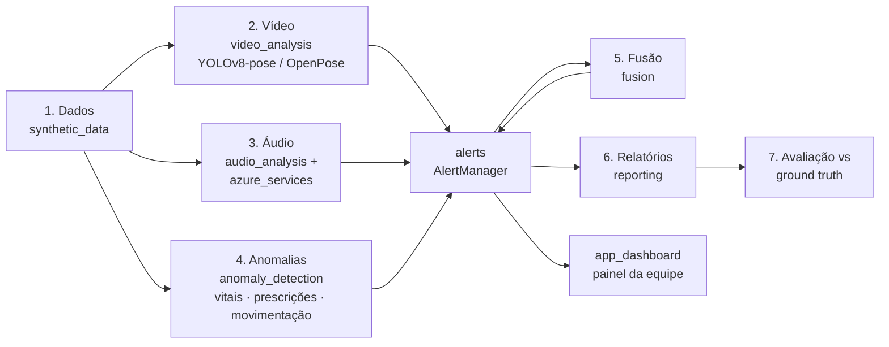
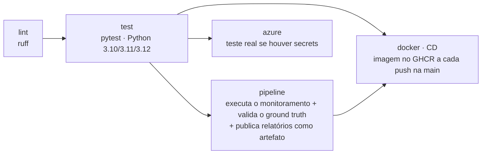

# Fase 4 — Monitoramento multimodal de pacientes 🩺

O hospital passa a monitorar continuamente os pacientes com **vídeo** (fisioterapia), **áudio** (consultas),
**texto** (transcrições), **sinais vitais**, **prescrições** e **movimentação no leito**. O sistema detecta
anomalias em cada fonte, **funde as evidências** e **alerta a equipe médica** com prioridade, destino e conduta sugerida.

Todos os comandos abaixo são executados a partir da raiz do repositório.

| Entregável | Onde |
|---|---|
| Código | [monitoramento/](monitoramento) (pacote), [run_multimodal_monitoring.py](run_multimodal_monitoring.py), [app_dashboard.py](app_dashboard.py) |
| Relatório técnico | [relatorio_tecnico_fase4.md](relatorio_tecnico_fase4.md) |
| Vídeo de demonstração | _<inserir link do YouTube/Vimeo>_ |

---

## ⚡ Início rápido

Pré-requisito: **Python 3.10+**. Nenhuma chave de API é necessária (sem chaves, roda em modo offline).

```bash
python -m venv .venv
# Windows: .\.venv\Scripts\Activate.ps1   ·   Linux/macOS: source .venv/bin/activate
pip install -r requirements.txt

python run_multimodal_monitoring.py   # executa o monitoramento (~20 s) e gera reports/
streamlit run app_dashboard.py        # painel de alertas da equipe médica (http://localhost:8501)
pip install -r requirements-dev.txt && pytest   # testes
```

Com Docker: `docker build -t fase4 .` e depois
`docker run --rm -p 8501:8501 --env-file .env fase4 dashboard`.

---

## 🔑 Chaves do Azure: o que precisa e o que acontece sem elas

As chaves ficam no arquivo **`.env`** na raiz do repositório (copie de [.env.example](.env.example); o `.env` não é versionado nem entra na imagem Docker).

| Variável | Usada por | Obrigatória? | Sem a chave |
|---|---|---|---|
| `AZURE_SPEECH_KEY`, `AZURE_SPEECH_REGION` | Azure Speech to Text (transcrição) e Text to Speech (demo) | Não | **Modo offline**: usa a transcrição de referência `.txt` do áudio. O log mostra `Speech to Text em MODO OFFLINE`. |
| `AZURE_LANGUAGE_KEY`, `AZURE_LANGUAGE_ENDPOINT` | Azure Text Analytics (sentimento, frases-chave, Text Analytics for Health) | Não | **Modo offline**: léxico de termos críticos com negação + sentimento léxico. |
| `ALERT_WEBHOOK_URL` | Envio de alertas ALTO/CRÍTICO ao Teams/Slack | Não | Alertas continuam no log, em `alerts.jsonl` e no painel. |

O modo em uso aparece no início do log (`Modo dos serviços: {...}`), no campo `modo_servicos` de
`reports/resultados.json` e no topo do painel. Para testar as credenciais: `python scripts/azure_smoke_test.py`.

**Criar as chaves gratuitamente:** no [portal Azure](https://portal.azure.com) crie um recurso **Speech** e um
**Language** na faixa de preço **Free F0** (região sugerida: East US) e copie a *CHAVE 1*, a região e o
endpoint de *Chaves e Ponto de extremidade* de cada recurso para o `.env`.

---

## 🧠 Fluxo de execução (o que acontece ao rodar `python run_multimodal_monitoring.py`)



| Etapa | O que faz | Saída (em `reports/`) |
|---|---|---|
| 1. Dados | Gera 48 h de dados de 3 pacientes com anomalias conhecidas (P001 controle, P002 sepse, P003 AVC) | `data/` |
| 2. Vídeo | Keypoints → ângulos articulares → protocolo do exercício, tremor (FFT), queda, supervisão (YOLOv8 conta pessoas), Isolation Forest | `relatorio_video_P00X.md`, `figures/video_P003_esqueleto.gif` |
| 3. Áudio | Jitter, shimmer, HNR, pausas, inspirações audíveis → fadiga / disartria / dificuldade respiratória; **Azure Speech to Text** + **Azure Text Analytics** | `figures/audio_indicadores.png` |
| 4. Anomalias | Sinais vitais **em streaming** (NEWS2 + z-score robusto + Isolation Forest + tendência, com filtro anti-artefato); regras de prescrição; queda/imobilidade/agitação | `sinais_vitais_scores.csv`, `figures/vitais_P00X.png` |
| 5. Fusão | Risco por paciente, com bônus quando ≥ 2 modalidades apontam o mesmo domínio clínico | `figures/fusao_multimodal.png` |
| 6. Alertas | Deduplicação, severidade (CRÍTICO/ALTO/MODERADO/INFO), destino (plantonista, enfermagem, painel), webhook | `alerts.jsonl`, `painel_alertas.md` |
| 7. Avaliação | Confere cada anomalia injetada e se o controle ficou sem alertas | `resultados.json` (`avaliacao`) |

O detalhamento dos modelos e dos resultados está em [relatorio_tecnico_fase4.md](relatorio_tecnico_fase4.md).

## 📊 Resultado resumido

| Verificação | Resultado |
|---|---|
| Sepse do P002 | 1º sinal **~2 h antes** do NEWS2 ≥ 5 (tendência + Isolation Forest) |
| Crises hipertensivas do P003 | detectadas em 10 min |
| Artefato de oxímetro do P001 | ignorado (filtro de persistência) |
| Vídeo do P003 | queda, assimetria, tremor de ~6 Hz e ausência do fisioterapeuta detectados |
| Voz | dispneia (P002) e disartria + fadiga (P003) identificadas; P001 normal |
| Paciente controle P001 | 0 alertas ALTO/CRÍTICO · risco fundido **BAIXO** |

## ⚙️ Opções de execução

```bash
python run_multimodal_monitoring.py --offline                                  # ignora Azure mesmo com chaves
python run_multimodal_monitoring.py --video sessao.mp4 --video-patient P003    # vídeo real (YOLOv8)*
python run_multimodal_monitoring.py --openpose pasta_json/                     # saída do OpenPose (BODY_25)
python run_multimodal_monitoring.py --audio consulta.wav --audio-patient P002  # gravação real
python run_multimodal_monitoring.py --vitals-csv bidmc_01_Numerics.csv         # PhysioNet BIDMC
python run_multimodal_monitoring.py --realtime 0.02                            # replay "ao vivo" dos vitais
```
\* Vídeo real requer `pip install -r requirements-video.txt` (ultralytics + PyTorch, ~2 GB). Os pesos YOLOv8 são baixados automaticamente.

## 🔁 CI/CD

O workflow [.github/workflows/ci.yml](.github/workflows/ci.yml) roda a cada push e pull request:



Para o job `azure` rodar no GitHub, cadastre em *Settings → Secrets and variables → Actions* os secrets
`AZURE_SPEECH_KEY`, `AZURE_SPEECH_REGION`, `AZURE_LANGUAGE_KEY` e `AZURE_LANGUAGE_ENDPOINT`. Sem eles o job é ignorado e o CI continua verde.

## 📁 Arquivos

| Arquivo | Função |
|---|---|
| [run_multimodal_monitoring.py](run_multimodal_monitoring.py) | **Orquestrador**: executa as 7 etapas e a avaliação. |
| [app_dashboard.py](app_dashboard.py) | **Painel Streamlit** da equipe médica: risco por paciente, fila de alertas, evidências, registro de ciência. |
| [monitoramento/config.py](monitoramento/config.py) | Caminhos, faixas clínicas de referência, leitura do `.env`. |
| [monitoramento/synthetic_data.py](monitoramento/synthetic_data.py) | Gera a coorte sintética (vitais, prescrições, movimentação, keypoints, voz) e carrega CSV real/PhysioNet. |
| [monitoramento/video_analysis.py](monitoramento/video_analysis.py) | Backend YOLOv8 (pose + objetos), leitor OpenPose, cinemática, detectores de desvio. |
| [monitoramento/audio_analysis.py](monitoramento/audio_analysis.py) | Biomarcadores vocais, indicadores clínicos, análise de texto offline. |
| [monitoramento/azure_services.py](monitoramento/azure_services.py) | Clientes REST do Azure Speech (STT/TTS) e Azure AI Language, com fallback offline. |
| [monitoramento/anomaly_detection.py](monitoramento/anomaly_detection.py) | Monitor de sinais vitais em streaming, regras de prescrição, monitor de movimentação. |
| [monitoramento/alerts.py](monitoramento/alerts.py) | `Alert` e `AlertManager` (deduplicação, roteamento, JSONL, webhook). |
| [monitoramento/fusion.py](monitoramento/fusion.py) | Fusão multimodal e alerta consolidado. |
| [monitoramento/reporting.py](monitoramento/reporting.py) | Figuras, GIF do esqueleto e relatórios Markdown. |
| [scripts/azure_smoke_test.py](scripts/azure_smoke_test.py) | Testa as credenciais Azure (TTS → STT → Language). |
| [tests/test_fase4.py](tests/test_fase4.py) | Testes automatizados da Fase 4. |

## 🌳 Estrutura do repositório

```text
fiap-trab.04/
├── README.md                     # este documento
├── relatorio_tecnico_fase4.md    # relatório técnico
├── run_multimodal_monitoring.py  # orquestrador
├── app_dashboard.py              # painel da equipe médica
├── monitoramento/                # pacote com os módulos de cada modalidade
├── scripts/azure_smoke_test.py   # teste das credenciais Azure
├── tests/                        # testes automatizados
├── requirements.txt              # dependências
├── requirements-dev.txt          # + pytest e ruff
├── requirements-video.txt        # + ultralytics (YOLOv8) para vídeos reais
├── pyproject.toml                # configuração do pytest e do ruff
├── .github/workflows/ci.yml      # CI/CD (GitHub Actions)
├── Dockerfile, docker-entrypoint.sh
├── .env.example                  # modelo das chaves Azure (copie para .env)
├── data/                         # dados sintéticos (gerados a cada execução)
└── reports/                      # saídas: relatórios, figuras, alertas, resultados.json
```
