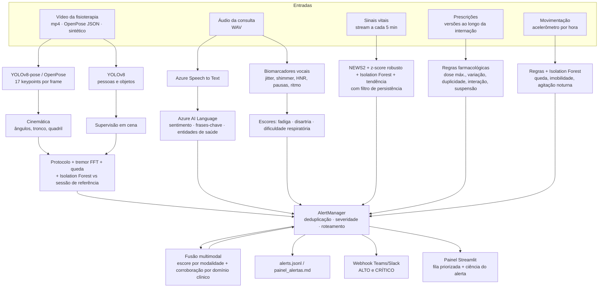
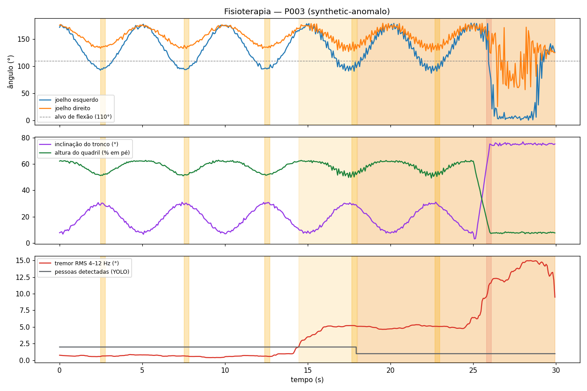
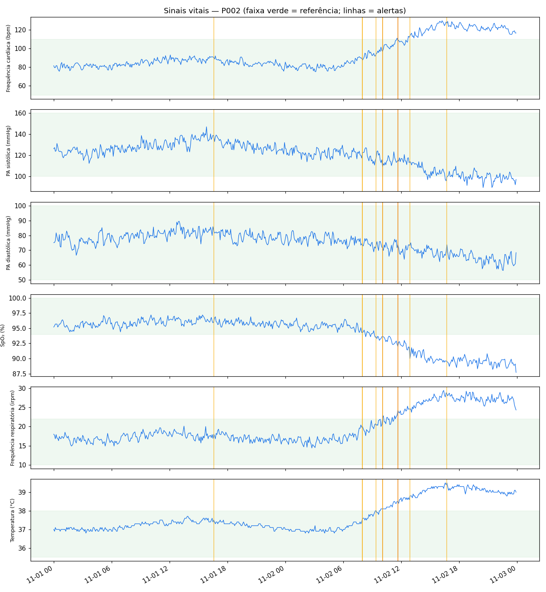
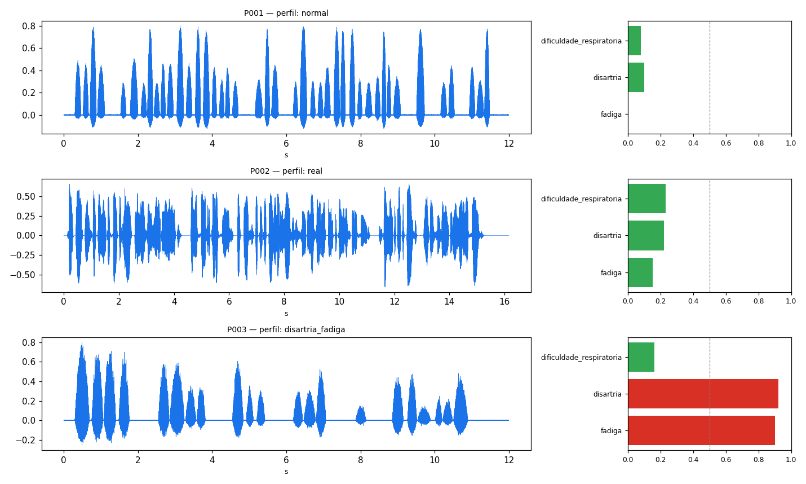
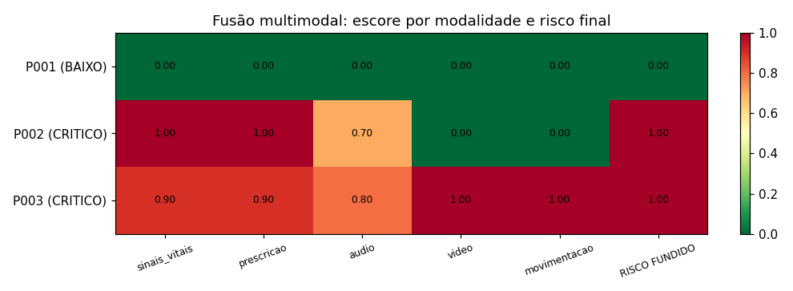
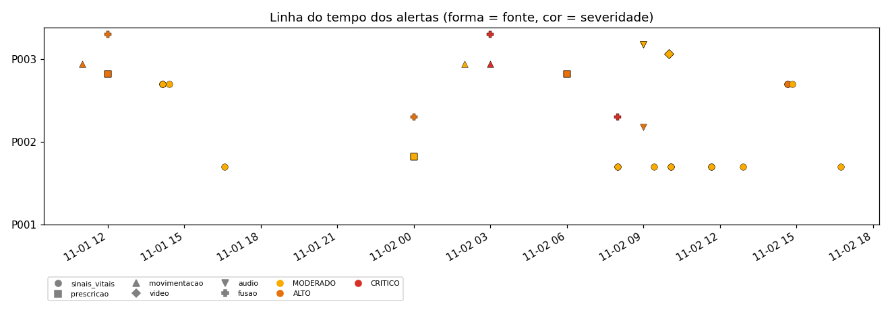

# Relatório Técnico — Tech Challenge Fase 4
**Monitoramento multimodal de pacientes: vídeo, áudio, texto e sinais vitais, com detecção de anomalias e alertas à equipe médica**

> Código: [monitoramento/](monitoramento) · Orquestrador: [run_multimodal_monitoring.py](run_multimodal_monitoring.py) · Painel: [app_dashboard.py](app_dashboard.py) · Testes: [tests/test_fase4.py](tests/test_fase4.py) · CI/CD: [.github/workflows/ci.yml](.github/workflows/ci.yml)

---

## 1. Objetivo e escopo

O hospital já usa IA para analisar exames e textos clínicos (Fases 1 e 2). Nesta fase o
sistema passa a **monitorar continuamente** o paciente com dados de naturezas diferentes e a
**avisar a equipe** quando algo foge do esperado:

| Requisito do enunciado | Onde está |
|---|---|
| Vídeo: processar sessões de fisioterapia, detectar movimentos fora do padrão (OpenPose / YOLOv8) e gerar relatório de desvios | [video_analysis.py](monitoramento/video_analysis.py), relatório automático em `reports/relatorio_video_<paciente>.md` |
| Áudio: detectar alterações vocais (cansaço, dificuldade respiratória), transcrever com **Azure Speech to Text** e analisar termos críticos/sentimento com **Azure Text Analytics** | [audio_analysis.py](monitoramento/audio_analysis.py), [azure_services.py](monitoramento/azure_services.py) |
| Anomalias em sinais vitais, prescrições e movimentação do paciente | [anomaly_detection.py](monitoramento/anomaly_detection.py) |
| Alertas automáticos para a equipe médica | [alerts.py](monitoramento/alerts.py), [app_dashboard.py](app_dashboard.py), webhook Teams/Slack |
| Fusão dos diferentes tipos de dado | [fusion.py](monitoramento/fusion.py) |

---

## 2. Fluxo multimodal

**Etapas do orquestrador** (`python run_multimodal_monitoring.py`), na ordem em que aparecem no log:

1. **Dados** — gera a coorte sintética (ou carrega dados reais passados por parâmetro).
2. **Vídeo** — keypoints → cinemática → desvios → relatório automático + GIF do esqueleto.
3. **Áudio** — biomarcadores acústicos + transcrição (Azure) + análise de texto (Azure).
4. **Anomalias** — sinais vitais *em streaming* (amostra a amostra), prescrições e movimentação.
5. **Fusão** — risco multimodal por paciente; alerta consolidado no momento em que o risco cruza ALTO/CRÍTICO.
6. **Relatórios** — figuras, painel de alertas, CSV/JSON.
7. **Avaliação** — confere cada anomalia injetada (ground truth) e se o paciente controle ficou sem alertas.

---

## 3. Dados

Vídeo e voz de pacientes são dados sensíveis (LGPD). O enunciado sugere PhysioNet e AudioSet,
mas eles exigem download/credenciamento e não têm os rótulos clínicos que queremos avaliar.
Por isso o projeto usa uma **coorte sintética com anomalias conhecidas**. É o ground truth
que permite medir o sistema. Todos os módulos também aceitam **dados reais**:

| Modalidade | Sintético (padrão) | Dado real aceito |
|---|---|---|
| Sinais vitais | 48 h, 1 amostra/5 min, ruído AR(1) + ritmo circadiano | CSV do projeto ou `bidmc_XX_Numerics.csv` do **PhysioNet BIDMC** (`--vitals-csv`) |
| Vídeo | keypoints COCO-17 de agachamentos (15 fps, 30 s) | vídeo `.mp4` via **YOLOv8** (`--video`) ou JSON do **OpenPose** (`--openpose`) |
| Áudio | voz sintetizada (fonte glotal + formantes) com jitter/shimmer/pausas controlados | qualquer WAV (`--audio`); `scripts/azure_smoke_test.py` gera uma consulta falada real com Azure TTS |
| Prescrições / movimentação | tabelas geradas | mesmo formato em CSV |

**Coorte simulada:**

| Paciente | Quadro | Anomalias injetadas |
|---|---|---|
| **P001** | Pós-operatório estável (**controle**) | apenas 1 artefato de oxímetro (SpO₂ = 71 % em uma única amostra), que **não** deve gerar alerta |
| **P002** | Pneumonia → sepse | deterioração progressiva a partir de 30 h (FC↑, FR↑, T↑, SpO₂↓, PA↓); voz com dispneia; dipirona 8 g/dia; suspensão de ceftriaxona após 24 h |
| **P003** | AVC isquêmico em reabilitação | 2 crises hipertensivas; fisioterapia com hemiparesia D, tremor 6 Hz, saída do fisioterapeuta e queda; voz com disartria/fadiga; 6 h imóvel, agitação noturna, queda do leito; enoxaparina ×6, BRA duplicado, AINE + anticoagulante |

---

## 4. Modelos aplicados em cada tipo de dado

### 4.1 Vídeo — análise postural e detecção de objetos
* **Pose:** `YoloBackend` usa **YOLOv8n-pose** (17 keypoints COCO por pessoa; o paciente é a pessoa
  com a maior caixa). `load_openpose_json` converte a saída **OpenPose BODY_25** para o mesmo formato,
  então qualquer um dos dois alimenta a mesma análise.
* **Objetos/pessoas:** **YOLOv8n** (COCO) conta as pessoas em cena para checar se há **supervisão**
  e registra objetos (cadeira de apoio etc.).
* **Cinemática:** ângulo de cada joelho (quadril–joelho–tornozelo), inclinação do tronco, altura do
  quadril normalizada pela altura em pé e velocidade vertical. Keypoints com confiança < 0,3 são
  interpolados (oclusões curtas).
* **Detectores:**

| Evento | Método | Critério |
|---|---|---|
| Repetições | vales do ângulo médio do joelho (`find_peaks`) | distância ≥ 2 s, proeminência 20° |
| Déficit de amplitude | por repetição | joelho não chega a ≤ 110° |
| Assimetria (hemiparesia/compensação) | por repetição | \|esq − dir\| > 12° |
| Compensação de tronco | por repetição | inclinação > 40° |
| **Tremor** | filtro passa-banda 4–12 Hz + RMS em janela de 2 s + Welch para a frequência | RMS > 2° por ≥ 1 s |
| **Queda** | altura do quadril < 30 % e tronco > 55° | ≥ 0,3 s; repetições posteriores não são avaliadas |
| **Sem supervisão** | contagem de pessoas (YOLOv8) | < 2 pessoas por > 3 s |
| Padrão anômalo | **Isolation Forest** treinado em uma sessão de referência executada corretamente | ≥ 0,5 s (informativo) |

### 4.2 Áudio — biomarcadores vocais + Azure
* **Acústica (numpy/scipy):** f0 por autocorrelação com correção da janela (Boersma), **HNR**,
  **jitter** e **shimmer** período a período, sílabas (trechos vozeados), frases e pausas
  (≥ 250 ms), **inspirações audíveis** (ruído não periódico dentro das pausas), irregularidade
  do ritmo e queda de intensidade ao longo da fala.
* **Escores clínicos (0–1):**
  * *fadiga* = fala lenta + pausas longas + queda de intensidade;
  * *disartria* = shimmer + jitter + ritmo irregular;
  * *dificuldade respiratória* = inspirações audíveis + frases curtas + muitas pausas + HNR baixo.
* **Azure Speech to Text** (REST, pt-BR, `format=detailed`): transcrição e confiança.
* **Azure AI Language / Text Analytics** (API 2023-04-01): `SentimentAnalysis` com *opinion
  mining*, `KeyPhraseExtraction` e **Text Analytics for Health** (sintomas, diagnósticos,
  medicamentos e **asserção de negação**, ex.: "não sinto dor no peito").
* **Modo offline** (sem chaves): transcrição de referência `.txt` + léxico de termos críticos
  com detecção de negação e sentimento léxico. Cada resultado traz o campo `provedor`, então
  sempre se sabe qual caminho foi usado. Se uma chamada ao Azure falha, o erro vai para o log e
  a análise local continua. **O monitoramento nunca para por causa da nuvem.**

### 4.3 Sinais vitais — quatro camadas em streaming
`StreamingVitalsMonitor.update(amostra)` processa uma amostra por vez, como um monitor de beira-leito:

1. **NEWS2** (Royal College of Physicians): ≥ 5 → ALTO (resposta urgente); ≥ 7 → CRÍTICO; parâmetro isolado com 3 pontos → ALTO.
2. **Faixa clínica + z-score robusto** (mediana/MAD de 6 h, com MAD mínimo por sinal para ignorar variações irrelevantes).
3. **Isolation Forest** multivariado treinado nas primeiras 12 h (período estável): pega combinações atípicas mesmo com cada sinal dentro da faixa.
4. **Tendência**: regressão linear em 3 h; ≥ 3 sinais piorando juntos → alerta precoce de deterioração.

**Filtro de persistência:** um desvio só vira alerta se durar ≥ 3 amostras (15 min). Excursões
mais curtas são registradas como **artefato** (em `resultados.json`) e não alertam. Isso trata o
problema clássico de falso alarme por sensor deslocado.

### 4.4 Prescrições
Regras sobre a **evolução** de cada medicamento entre versões da prescrição:
dose diária > máximo (CRÍTICO se > 1,5×), aumento ≥ 2× (ALTO se for de alta vigilância),
redução ≤ 0,4×, **duplicidade terapêutica** (mesma classe), **interação** (anticoagulante + AINE)
e **suspensão abrupta** de antibiótico antes do curso mínimo sem substituto da mesma classe.

### 4.5 Movimentação durante a internação
Regras clínicas (queda: pico ≥ 3 g → CRÍTICO; **imobilidade** ≥ 4 h → ALTO, risco de lesão por
pressão; **agitação noturna** 0–5 h → MODERADO, triagem de delirium) + **Isolation Forest**
treinado numa coorte de referência para padrões atípicos não cobertos pelas regras (INFO).

### 4.6 Fusão multimodal (late fusion)
Cada modalidade vira um escore s ∈ [0,1] (severidade máxima + 0,05 por alerta extra). O risco é
`0,6·max(s) + 0,4·Σ wₘ·sₘ` mais um **bônus de corroboração** de +0,1 para cada domínio clínico
(respiratório, neurológico, queda, ...) apontado por **≥ 2 modalidades independentes** (máx. +0,3).
A fusão é recalculada em ordem cronológica e emite um alerta consolidado **no momento** em que o
paciente cruza ALTO e de novo se escalar para CRÍTICO.

### 4.7 Alertas
`AlertManager` deduplica por (paciente, fonte, título, severidade) numa janela deslizante de
120 min. Assim, uma condição persistente não gera alarmes repetidos, mas **uma escalada sempre
gera alerta novo**. O roteamento segue a severidade:

| Severidade | Destino |
|---|---|
| CRÍTICO | Médico plantonista + Enfermagem (imediato) |
| ALTO | Enfermagem do setor (até 15 min) |
| MODERADO | Painel de monitoramento (próxima ronda) |
| INFO | Registro / auditoria |

Canais: log, `alerts.jsonl` (auditoria), `painel_alertas.md`, **webhook** (Teams/Slack) para
ALTO/CRÍTICO e o **painel Streamlit**, onde o profissional registra ciência do alerta.

---

## 5. Resultados

Execução padrão (`python run_multimodal_monitoring.py`, ~20 s, sem GPU). Todas as verificações
contra o ground truth passaram, e o CI repete essa validação a cada push.

### 5.1 Avaliação contra as anomalias injetadas

| Verificação | Resultado |
|---|---|
| P001: artefato de oxímetro ignorado | ✅ nenhum alerta (18 excursões transitórias descartadas na coorte) |
| P002: sepse (início 02/11 06:00) | ✅ 1º sinal em **120 min** (Isolation Forest + *tendência de deterioração*, MODERADO); NEWS2 ≥ 5 em 245 min; NEWS2 ≥ 7 em 340 min |
| P003: crise hipertensiva 01/11 14:00 | ✅ ALTO em 10 min |
| P003: crise hipertensiva 02/11 14:30 | ✅ ALTO em 10 min |
| P001 (controle) sem alertas ALTO/CRÍTICO | ✅ 0 alertas; risco fundido 0,00 (BAIXO) |
| Vídeo P003: queda, assimetria, tremor, falta de supervisão | ✅ todos detectados (+ déficit de amplitude em 5/5 repetições avaliadas) |
| Vídeo P001 (execução correta) | ✅ 6/6 repetições conformes, nenhum desvio |
| Áudio P001 (normal) | ✅ fadiga 0,00 · disartria 0,10 · respiratório 0,08 |
| Áudio P002 (dispneia) | ✅ respiratório **1,00** (9 inspirações audíveis, frases de 0,5 s) |
| Áudio P003 (disartria + fadiga) | ✅ disartria **0,92** (shimmer 13 %, jitter 3,2 %) · fadiga **0,90** (2,5 sílabas/s) |

A camada de **tendência + Isolation Forest** antecipou a deterioração séptica em **~2 h** em
relação ao NEWS2 ≥ 5. Esse é justamente o ganho esperado do monitoramento contínuo com
detecção de anomalias em relação às regras clássicas.

Os indicadores vocais foram testados com **10 sementes aleatórias por perfil**, e todas
classificaram corretamente (também coberto em `tests/test_fase4.py`).

### 5.2 Exemplos de anomalias detectadas

**Vídeo (P003)** — trecho do relatório automático `reports/relatorio_video_P003.md`:

| t (s) | Evento | Severidade | Descrição |
|---|---|---|---|
| 2,5 | assimetria | MODERADO | 40,7° entre joelhos (limite 12°), possível hemiparesia |
| 2,5 | déficit de amplitude | MODERADO | joelho direito parou em 133° (alvo ≤ 110°) |
| 14,5 | tremor | MODERADO | ~6,1 Hz, RMS máx. 15° |
| 18,0 | sem supervisão | ALTO | fisioterapeuta fora de cena de 18,0 s a 29,9 s |
| 25,8 | **queda** | **CRÍTICO** | quadril a 19 % da altura, tronco tombado; sessão interrompida |

**Sinais vitais (P002)** — sequência de alertas da sepse: *Tendência de deterioração* e
*Padrão multivariado atípico* (08:00) → *SpO₂ abaixo da faixa* (09:25) → *NEWS2 ≥ 5* (10:05) →
*NEWS2 ≥ 7 — resposta de emergência* (11:40).

**Prescrição:** "Dose acima do máximo: dipirona — 2000 mg × 4/dia = 8000 mg/dia (máximo 4000)"
(CRÍTICO); "Interação medicamentosa relevante — anticoagulante + AINE" (ALTO).

**Áudio + texto:** P002 com *Padrão de fala com dificuldade respiratória* e *Termos críticos na
consulta* (falta de ar, febre, calafrios, dor no peito, sentimento negativo). No P003, "Não sinto
dor no peito" é reconhecido como **negado** e não conta como sintoma.

### 5.3 Fusão

| Paciente | Vitais | Prescrição | Áudio | Vídeo | Movim. | Domínios convergentes | Risco |
|---|---|---|---|---|---|---|---|
| P001 | 0,00 | 0,00 | 0,00 | 0,00 | 0,00 | — | **0,00 BAIXO** |
| P002 | 1,00 | 1,00 | 0,75 | — | 0,00 | respiratório, cardiovascular, infeccioso | **1,00 CRÍTICO** |
| P003 | 0,90 | 0,90 | 0,80 | 1,00 | 1,00 | neurológico (áudio + vídeo + movim.), queda (áudio + vídeo + movim.) | **1,00 CRÍTICO** |

A corroboração mostra o valor da fusão: no P003, a **queda** aparece de forma independente no
acelerômetro (4,3 g às 03:00), no vídeo da fisioterapia (25,8 s) e no relato do paciente ("ontem
à noite eu caí"). No P002, a hipoxemia nos sinais vitais é confirmada pela voz (pausas
inspiratórias) e pelo texto ("falta de ar").

### 5.4 Volume de alertas
48 alertas no total para 3 pacientes × 48 h (6 CRÍTICO, 20 ALTO, 17 MODERADO, 5 INFO), com
**11 repetições suprimidas** pela deduplicação. O paciente controle gerou 1 único alerta
(INFO). Isso é relevante porque **fadiga de alarme** é um dos principais motivos de falha de
sistemas de monitoramento.

---

## 6. Integração com Azure

| Serviço | Uso | Endpoint |
|---|---|---|
| Azure AI Speech — Speech to Text | transcrição das consultas (pt-BR) | `https://{região}.stt.speech.microsoft.com/speech/recognition/conversation/cognitiveservices/v1` |
| Azure AI Speech — Text to Speech | demonstração: gerar consulta falada real | `https://{região}.tts.speech.microsoft.com/cognitiveservices/v1` |
| Azure AI Language | sentimento + opinion mining, frases-chave | `{endpoint}/language/:analyze-text?api-version=2023-04-01` |
| Azure AI Language — Text Analytics for Health | entidades clínicas com negação | `{endpoint}/language/analyze-text/jobs?api-version=2023-04-01` (assíncrono) |

**Como habilitar:** crie os recursos *Speech* e *Language* no portal Azure (o nível gratuito F0 é
suficiente), copie `.env.example` para `.env` e preencha as chaves. Depois rode
`python scripts/azure_smoke_test.py`, que faz o ciclo TTS → STT → Language, e em seguida
`python run_multimodal_monitoring.py --audio data/consulta_azure_tts.wav --audio-patient P002`.

**Sem chaves**, tudo roda em modo offline e o log mostra, por exemplo:
`WARNING | Speech to Text em MODO OFFLINE (defina AZURE_SPEECH_KEY e AZURE_SPEECH_REGION ...)`.
As chamadas REST são cobertas por testes com *mocks* (`test_azure_speech_to_text_mock`,
`test_azure_language_mock`), então o formato das requisições e o *parsing* das respostas são
verificados mesmo no CI sem credenciais. Se os *secrets* existirem no GitHub, o job `azure` do
CI executa o teste de integração real.

> Observação: o áudio sintético dos pacientes não é fala inteligível (serve para medir
> biomarcadores com ground truth). Por isso, quando o Azure devolve transcrição vazia, o sistema
> usa a transcrição de referência e registra o motivo (`observacao` no resultado). Para a
> demonstração com voz real, use o áudio gerado pelo `azure_smoke_test.py` ou grave um WAV.

---

## 7. Qualidade, CI/CD e reprodutibilidade
* **22 testes automatizados** (pytest), cobrindo NEWS2, artefato vs. persistência, sepse,
  regras de prescrição, movimentação, vídeo de referência vs. anômalo, perfis vocais, negação no
  texto, clientes Azure (mock), deduplicação/escalada, fusão e o **pipeline de ponta a ponta**.
  Também há testes rápidos das Fases 1 e 2.
* **GitHub Actions** ([ci.yml](.github/workflows/ci.yml)): lint (ruff) → testes em Python
  3.10/3.11/3.12 → execução do pipeline com validação do ground truth e publicação dos relatórios
  como artefato → integração Azure (opcional) → **CD**: imagem Docker publicada no GitHub
  Container Registry a cada push na `main`.
* **Docker:** `docker run ... monitoramento-fase4` (pipeline) ou `... dashboard` (painel).
* Tudo é determinístico (sementes fixas).

## 8. Limitações e próximos passos
* Os limiares vocais foram calibrados para o extrator deste projeto. Em produção o ideal é
  calibrar **por paciente** (comparar com consultas anteriores) e validar com dados clínicos
  rotulados (ex.: TORGO para disartria).
* A análise de vídeo assume vista lateral e um exercício específico; outros protocolos exigem
  novos critérios (o dicionário `PROTOCOL` é configurável).
* O NEWS2 assume paciente alerta e em ar ambiente; integrar nível de consciência e O₂
  suplementar do prontuário.
* A base de fármacos/interações é ilustrativa. Em produção, integrar a uma base farmacológica
  oficial.
* O sistema é **apoio à decisão**: todo alerta exige avaliação humana.
