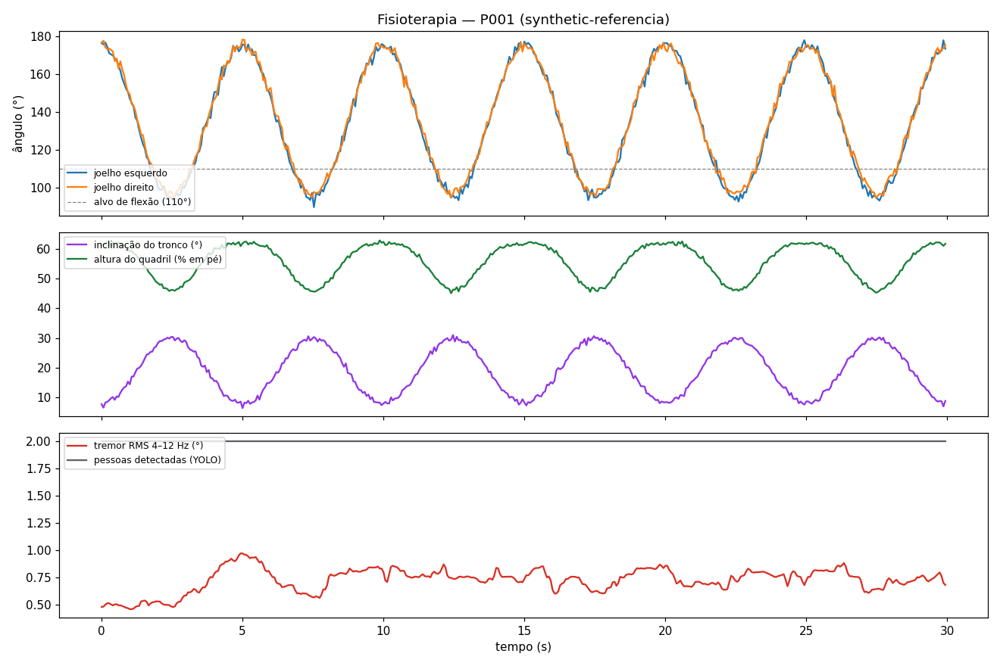

# Relatório automático — Análise de vídeo (P001)

- **Fonte:** `synthetic-referencia` · duração 29.9 s · 15.0 fps
- **Protocolo:** Agachamento assistido (reabilitação de membros inferiores)
- **Repetições avaliadas:** 6 (6 conformes)
- **Amplitude média (ângulo mínimo do joelho):** esq. 92.8° · dir. 95.5°
- **Conclusão:** Sessão conforme o protocolo.

## Critérios do protocolo
| Critério | Limite |
|---|---|
| Flexão do joelho em cada repetição | ≤ 110° |
| Assimetria entre joelhos | ≤ 12° |
| Inclinação do tronco | ≤ 40° |
| Tremor (RMS 4–12 Hz) | ≤ 2.0° |
| Supervisão | ≥ 2 pessoas em cena; ausência ≤ 3.0 s |

## Repetições
| repeticao | t | joelho_esq_min | joelho_dir_min | assimetria | tronco_max | conforme |
|---|---|---|---|---|---|---|
| 1 | 2.47 | 93.5 | 95.3 | 1.4 | 30.4 | True |
| 2 | 7.4 | 89.9 | 95.2 | 2.1 | 30.6 | True |
| 3 | 12.53 | 93.5 | 94.9 | 1.1 | 31.0 | True |
| 4 | 17.4 | 93.5 | 95.7 | 1.7 | 30.6 | True |
| 5 | 22.47 | 92.8 | 97.1 | 2.5 | 30.1 | True |
| 6 | 27.53 | 93.4 | 95.0 | 1.7 | 30.2 | True |

## Desvios / eventos detectados
_(nenhum)_

