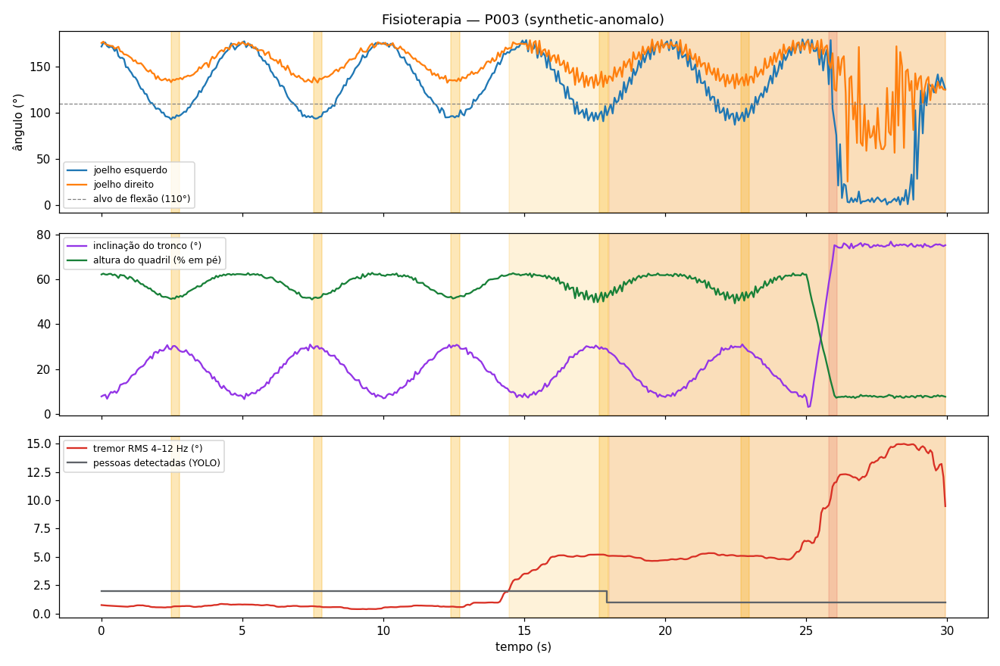

# Relatório automático — Análise de vídeo (P003)

- **Fonte:** `synthetic-anomalo` · duração 29.9 s · 15.0 fps
- **Protocolo:** Agachamento assistido (reabilitação de membros inferiores)
- **Repetições avaliadas:** 5 (0 conformes) — **sessão interrompida por queda**
- **Amplitude média (ângulo mínimo do joelho):** esq. 91.8° · dir. 130.5°
- **Conclusão:** **Sessão com desvios relevantes** — queda; sem_supervisao

## Critérios do protocolo
| Critério | Limite |
|---|---|
| Flexão do joelho em cada repetição | ≤ 110° |
| Assimetria entre joelhos | ≤ 12° |
| Inclinação do tronco | ≤ 40° |
| Tremor (RMS 4–12 Hz) | ≤ 2.0° |
| Supervisão | ≥ 2 pessoas em cena; ausência ≤ 3.0 s |

## Repetições
| repeticao | t | joelho_esq_min | joelho_dir_min | assimetria | tronco_max | conforme |
|---|---|---|---|---|---|---|
| 1 | 2.47 | 92.7 | 133.2 | 40.7 | 30.7 | False |
| 2 | 7.53 | 93.6 | 132.8 | 39.6 | 30.9 | False |
| 3 | 12.4 | 94.9 | 132.7 | 38.9 | 30.8 | False |
| 4 | 17.67 | 90.8 | 127.0 | 37.3 | 30.5 | False |
| 5 | 22.67 | 87.1 | 126.6 | 39.3 | 31.0 | False |

## Desvios / eventos detectados
| t | fim | tipo | severidade | descricao |
|---|---|---|---|---|
| 0.73 | 4.27 | padrao_anomalo | INFO | Movimento fora do padrão da sessão de referência (0.7s–4.3s). |
| 2.47 |  | deficit_amplitude | MODERADO | Rep. 1: joelho direito não atingiu 110° (mín. 133.2°). |
| 2.47 |  | assimetria | MODERADO | Rep. 1: assimetria de 40.7° entre joelhos (limite 12°) — possível hemiparesia/compensação. |
| 5.73 | 9.27 | padrao_anomalo | INFO | Movimento fora do padrão da sessão de referência (5.7s–9.3s). |
| 7.53 |  | deficit_amplitude | MODERADO | Rep. 2: joelho direito não atingiu 110° (mín. 132.8°). |
| 7.53 |  | assimetria | MODERADO | Rep. 2: assimetria de 39.6° entre joelhos (limite 12°) — possível hemiparesia/compensação. |
| 10.6 | 14.27 | padrao_anomalo | INFO | Movimento fora do padrão da sessão de referência (10.6s–14.3s). |
| 12.4 |  | deficit_amplitude | MODERADO | Rep. 3: joelho direito não atingiu 110° (mín. 132.7°). |
| 12.4 |  | assimetria | MODERADO | Rep. 3: assimetria de 38.9° entre joelhos (limite 12°) — possível hemiparesia/compensação. |
| 14.47 | 29.93 | tremor | MODERADO | Tremor de ~6.1 Hz entre 14.5s e 29.9s (RMS máx. 15.0°). |
| 15.73 | 19.33 | padrao_anomalo | INFO | Movimento fora do padrão da sessão de referência (15.7s–19.3s). |
| 17.67 |  | deficit_amplitude | MODERADO | Rep. 4: joelho direito não atingiu 110° (mín. 127.0°). |
| 17.67 |  | assimetria | MODERADO | Rep. 4: assimetria de 37.3° entre joelhos (limite 12°) — possível hemiparesia/compensação. |
| 18.0 | 29.93 | sem_supervisao | ALTO | Paciente sem fisioterapeuta no campo de visão de 18.0s a 29.9s. |
| 20.67 | 24.27 | padrao_anomalo | INFO | Movimento fora do padrão da sessão de referência (20.7s–24.3s). |
| 22.67 |  | deficit_amplitude | MODERADO | Rep. 5: joelho direito não atingiu 110° (mín. 126.6°). |
| 22.67 |  | assimetria | MODERADO | Rep. 5: assimetria de 39.3° entre joelhos (limite 12°) — possível hemiparesia/compensação. |
| 25.0 | 29.93 | padrao_anomalo | INFO | Movimento fora do padrão da sessão de referência (25.0s–29.9s). |
| 25.8 |  | queda | CRITICO | Perda de equilíbrio/queda aos 25.8s (quadril a 0.19 da altura, velocidade -0.63/s). |

