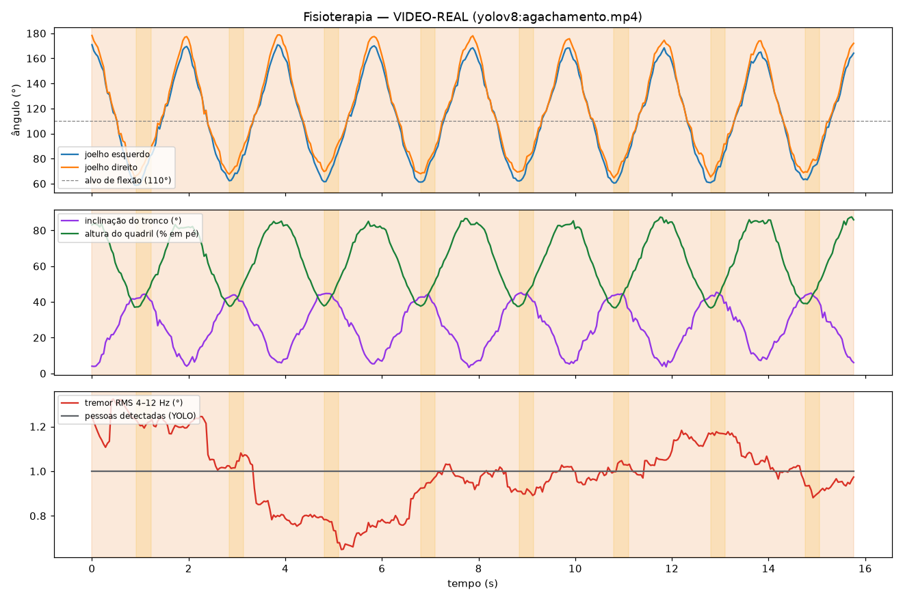

# Relatório automático — Análise de vídeo (VIDEO-REAL)

- **Fonte:** `yolov8:agachamento.mp4` · duração 15.8 s · 25.0 fps
- **Protocolo:** Agachamento assistido (reabilitação de membros inferiores)
- **Repetições avaliadas:** 8 (0 conformes)
- **Amplitude média (ângulo mínimo do joelho):** esq. 61.3° · dir. 67.4°
- **Conclusão:** **Sessão com desvios relevantes** — sem_supervisao

## Critérios do protocolo
| Critério | Limite |
|---|---|
| Flexão do joelho em cada repetição | ≤ 110° |
| Assimetria entre joelhos | ≤ 12° |
| Inclinação do tronco | ≤ 40° |
| Tremor (RMS 4–12 Hz) | ≤ 2.0° |
| Supervisão | ≥ 2 pessoas em cena; ausência ≤ 3.0 s |

## Repetições
| repeticao | t | joelho_esq_min | joelho_dir_min | assimetria | tronco_max | conforme |
|---|---|---|---|---|---|---|
| 1 | 0.92 | 58.6 | 65.6 | 7.5 | 44.3 | False |
| 2 | 2.84 | 62.4 | 67.6 | 6.2 | 43.9 | False |
| 3 | 4.8 | 61.6 | 69.7 | 7.3 | 44.7 | False |
| 4 | 6.8 | 61.3 | 68.0 | 6.0 | 44.3 | False |
| 5 | 8.84 | 62.1 | 69.3 | 6.4 | 45.1 | False |
| 6 | 10.8 | 60.5 | 64.6 | 5.2 | 44.5 | False |
| 7 | 12.8 | 60.8 | 65.4 | 5.9 | 45.4 | False |
| 8 | 14.76 | 63.1 | 68.8 | 5.2 | 44.9 | False |

## Desvios / eventos detectados
| t | fim | tipo | severidade | descricao |
|---|---|---|---|---|
| 0.0 | 15.76 | sem_supervisao | ALTO | Paciente sem fisioterapeuta no campo de visão de 0.0s a 15.8s. |
| 0.92 |  | compensacao_tronco | MODERADO | Rep. 1: inclinação do tronco 44.3°. |
| 2.84 |  | compensacao_tronco | MODERADO | Rep. 2: inclinação do tronco 43.9°. |
| 4.8 |  | compensacao_tronco | MODERADO | Rep. 3: inclinação do tronco 44.7°. |
| 6.8 |  | compensacao_tronco | MODERADO | Rep. 4: inclinação do tronco 44.3°. |
| 8.84 |  | compensacao_tronco | MODERADO | Rep. 5: inclinação do tronco 45.1°. |
| 10.8 |  | compensacao_tronco | MODERADO | Rep. 6: inclinação do tronco 44.5°. |
| 12.8 |  | compensacao_tronco | MODERADO | Rep. 7: inclinação do tronco 45.4°. |
| 14.76 |  | compensacao_tronco | MODERADO | Rep. 8: inclinação do tronco 44.9°. |

